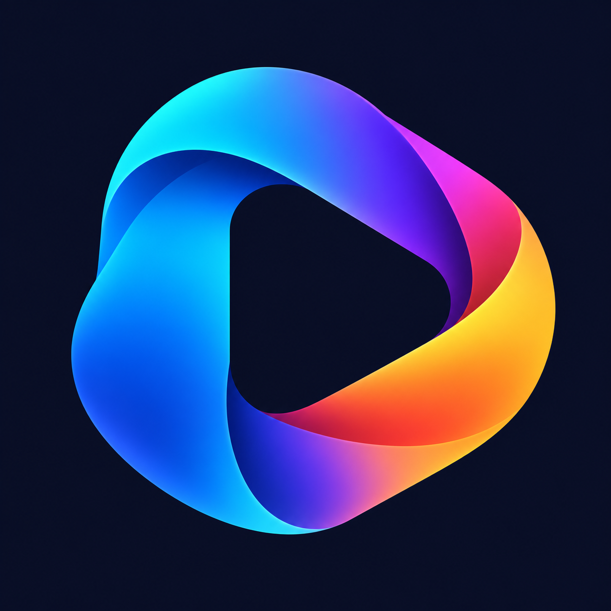

# go2rtc App icon concepts

Created on 2026-10-11 using built-in image generation, not a CLI fallback.

Both files are unmodified generated PNG originals, 1254 × 1254 pixels.

- [Variant 1](go2rtc-icon-v1.png): camera with a play symbol and flowing contour.
- [Variant 2](go2rtc-icon-v2.png): abstract streaming loop with a play-shaped negative space.

 

Variant 1 is selected for the App's active branding. Its unchanged PNG is also
provided as [`home-assistant/icon.png`](../../home-assistant/icon.png) and
[`home-assistant/logo.png`](../../home-assistant/logo.png), the native Home
Assistant App-store assets. Variant 2 remains an alternative, not a second
active identity. A store metadata refresh picks up the assets without changing
the running container or its settings. The original prompts remain below.

## Prompt for variant 1

```text
Use case: logo-brand
Asset type: standalone square app icon for go2rtc, a generic local camera and live-streaming application used with Home Assistant.
Primary request: create one beautiful, original, production-quality app icon, 1024 by 1024 pixels.
Subject: a single bold geometric camera mark with a clean play-triangle cutout in its lens; the surrounding camera contour subtly suggests smooth continuous streaming.
Style/medium: contemporary flat graphic icon, optically balanced rounded geometry, crisp edges, confident simple silhouette, restrained premium finish.
Composition/framing: front-on square icon artwork, centered mark with generous safe margin, fills the square background; legible at 32 pixels on both light and dark interfaces.
Constraints: one icon only, not a mockup or contact sheet. No text, letters, numbers, watermark, camera-brand logo, cloud symbol, Amazon or Home Assistant logo. No tiny details, photographic scene, beveled 3D object or drop-shadow outside the icon. Do not imitate an existing logo.
```

## Prompt for variant 2

```text
Use case: logo-brand
Asset type: standalone square app icon for go2rtc, a generic local camera and live-streaming application used with Home Assistant.
Primary request: create one beautiful, original, production-quality alternative app icon, 1024 by 1024 pixels.
Subject: one elegant continuous ribbon-like streaming loop enclosing a clear negative-space play triangle; the loop should express a stable flow of live video with a distinctive simple silhouette.
Style/medium: contemporary polished graphic icon, bold clean shapes with a restrained smooth tonal finish, excellent optical balance, no clutter.
Composition/framing: front-on square icon artwork, centered single mark with generous safe margin, fills the square background; instantly recognizable at 32 pixels on both light and dark interfaces.
Constraints: one icon only, not a mockup or contact sheet. No text, letters, numbers, watermark, camera-brand logo, cloud symbol, Amazon or Home Assistant logo. No network diagrams, tiny dots, photographic scene, beveled 3D object or drop-shadow outside the icon. Do not imitate an existing logo.
```
